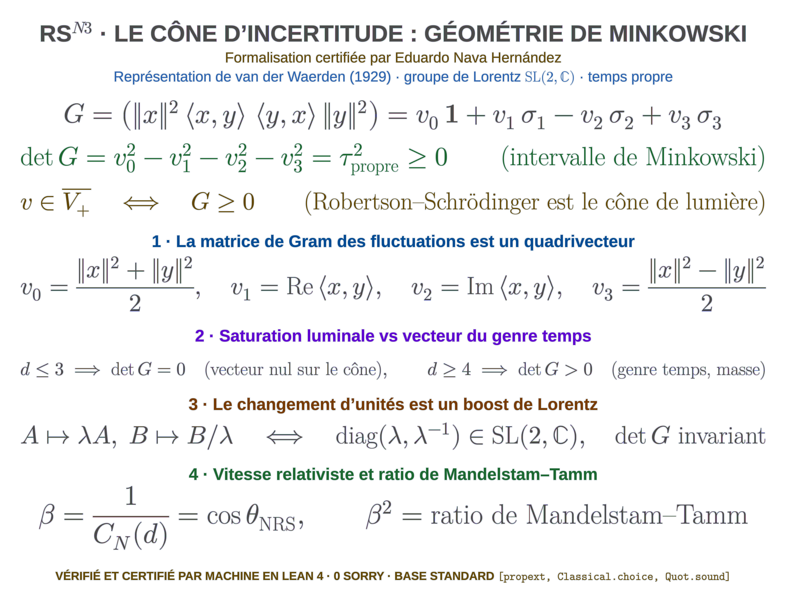
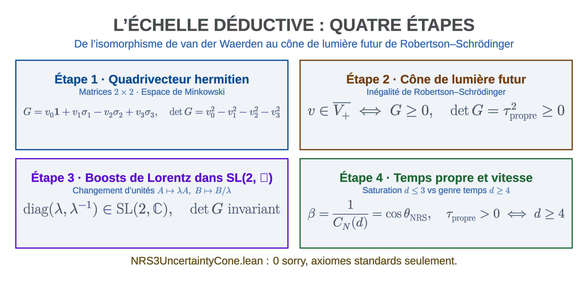
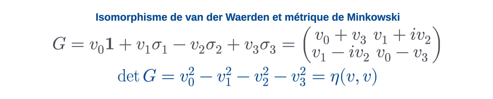
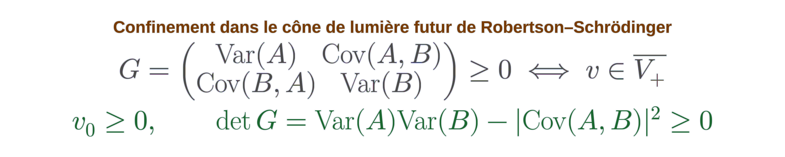
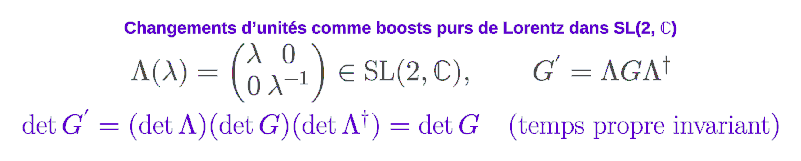
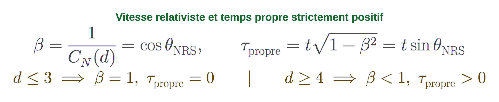

<div align="center">

# RS<sup>N</sup>³ · Le Cône d'Incertitude
### L'incertitude d'une paire d'observables est un quadrivecteur de Minkowski strictement enfermé dans le cône de lumière futur

**Eduardo Nava Hernández**  
*Vérification formelle certifiée en Lean 4 · 0 sorry · Mathlib (ZFC)*

[](https://leanprover.github.io/)
[](https://github.com/leanprover-community/mathlib4)
[](Verification/Axioms.lean)
[](https://github.com/leanprover-community/physlib/pulls?q=is%3Apr+is%3Amerged+author%3Anaype888-cloud)
[](https://naype888-cloud.github.io/nrs3-uncertainty-cone/)

**[▶ Essayer en ligne : Le cône d'incertitude 3D](https://naype888-cloud.github.io/nrs3-uncertainty-cone/)** · **[▶ Boosts et rotations SL(2, ℂ)](https://naype888-cloud.github.io/nrs3-uncertainty-cone/lorentz.html)** · **[▶ Dilatation temporelle et temps propre relativiste](https://naype888-cloud.github.io/nrs3-uncertainty-cone/dilatacion.html)**

</div>

---

> ### 🏛️ Ce qui distingue le théorème : van der Waerden et la géométrie causale de l'incertitude
>
> Sur `ℋ_d = ℂ^d`, la matrice de Gram des fluctuations de transport T_d et de position P_d est une matrice hermitienne `2 × 2`. D'après van der Waerden (1929), toute matrice hermitienne `2 × 2` est un quadrivecteur de l'espace de Minkowski dont le déterminant est l'intervalle relativiste `det G = τ² ≥ 0`.
>
> <div align="center">
> <picture><source media="(prefers-color-scheme: dark)" srcset="assets/oscuro/plaque_cone_master.png"></picture>
> </div>
>
> **1 · Robertson–Schrödinger est le cône de lumière.** La positivité semi-définie `G ≥ 0` équivaut exactement à ce que le quadrivecteur `v` appartienne au cône causal futur fermé `v ∈ V̄₊`.
>
> **2 · Saturation luminale vs masse.** En dimension pure `d ≤ 3` à l'état de courant maximal, `det G = 0` : le vecteur est nul et repose sur la surface du cône (propagation à la vitesse de la lumière). Dès `d ≥ 4`, le défaut géométrique de Szegő le propulse strictement à l'intérieur du cône (`det G > 0`, vecteur du genre temps, temps propre relativiste positif, masse au repos).
>
> **3 · Le changement d'unités est un boost de Lorentz.** La transformation d'échelle `A ↦ λA`, `B ↦ B/λ` correspond exactement au boost diagonal `diag(λ, λ⁻¹) ∈ SL(2, ℂ)` le long du troisième axe spatial : l'intervalle relativiste `det G` reste invariant.
>
> **4 · Vitesse relativiste et Mandelstam–Tamm.** La vitesse spatiale dans le référentiel équilibré est `β = 1 / C_N(d) = cos θ_NRS`, et son carré `β²` sature la borne de Mandelstam–Tamm.

---

## ⚡ Résumé formel

* Toute matrice hermitienne `2 × 2` s'identifie à un quadrivecteur `v = (v₀, v₁, v₂, v₃)` vérifiant `det G = v₀² − v₁² − v₂² − v₃²` : [`NRS3UncertaintyCone/VanDerWaerden1929.lean`](NRS3UncertaintyCone/VanDerWaerden1929.lean) (`det_herm`, `herm_coords`).
* Une matrice hermitienne est semi-définie positive si et seulement si son vecteur associé est causal futur : [`NRS3UncertaintyCone/VanDerWaerden1929.lean`](NRS3UncertaintyCone/VanDerWaerden1929.lean) (`future_of_posSemidef`).
* L'action par congruence de `SL(2, ℂ)` préserve identiquement l'intervalle de Minkowski et le cône causal : [`NRS3UncertaintyCone/VanDerWaerden1929.lean`](NRS3UncertaintyCone/VanDerWaerden1929.lean) (`det_conj`, `posSemidef_conj`).
* La matrice de Gram des fluctuations de deux observables est toujours un vecteur causal futur : [`NRS3UncertaintyCone/VanDerWaerden1929.lean`](NRS3UncertaintyCone/VanDerWaerden1929.lean) (`robertsonSchrodinger_future`).
* L'intervalle de Minkowski coïncide avec le défaut de Gram `det G = η(v, v)` : [`NRS3UncertaintyCone/Cone.lean`](NRS3UncertaintyCone/Cone.lean) (`det_gramMatrix`).
* Le vecteur est nul si et seulement si l'inégalité de Cauchy–Schwarz est saturée avec égalité : [`NRS3UncertaintyCone/Cone.lean`](NRS3UncertaintyCone/Cone.lean) (`interval_eq_zero_iff`).
* À l'état de courant maximal pour `d ≥ 4`, le vecteur est strictement du genre temps : [`NRS3UncertaintyCone/Cone.lean`](NRS3UncertaintyCone/Cone.lean) (`timelike_maxCurrentState`).
* Le temps propre relativiste est borné par le temps coordonnée `τ ≤ t` et est strictement positif à courant maximal : [`NRS3UncertaintyCone/TimeDilation.lean`](NRS3UncertaintyCone/TimeDilation.lean) (`properTime_le_time`, `properTime_maxCurrentState_pos`).
* Le voyage aller-retour vérifie rigoureusement l'inégalité triangulaire de la relativité : [`NRS3UncertaintyCone/RoundTrip.lean`](NRS3UncertaintyCone/RoundTrip.lean) (`two_mul_properTime_le_round_trip`).

---

## 📐 Démonstration constructive en quatre étapes

<div align="center">
<picture><source media="(prefers-color-scheme: dark)" srcset="assets/oscuro/plaque_cone_etapes.png"></picture>
</div>

### Étape 1 : Isomorphisme de van der Waerden et quadrivecteurs

> **Proposition 1.1 (Décomposition dans la base de Pauli).** Soit `G` une matrice hermitienne `2 × 2`. Il existe un unique quadrivecteur réel `v = (v₀, v₁, v₂, v₃)` tel que `G = v₀ 1 + v₁ σ₁ − v₂ σ₂ + v₃ σ₃`, et son déterminant coïncide avec la métrique de Minkowski `det G = v₀² − v₁² − v₂² − v₃²`.

<div align="center"><picture><source media="(prefers-color-scheme: dark)" srcset="assets/oscuro/plaque_cone_etape1.png"></picture></div>

*Module formel :* [`NRS3UncertaintyCone/VanDerWaerden1929.lean`](NRS3UncertaintyCone/VanDerWaerden1929.lean) (`det_herm`, `herm_coords`, `future_of_posSemidef`).

---

### Étape 2 : Robertson–Schrödinger comme géométrie du cône causal

> **Proposition 2.1 (Caractère causal futur de la matrice de Gram).** Pour tout état quantique et toute paire d'observables, la matrice de Gram des fluctuations satisfait `G ≥ 0`. Par conséquent, le quadrivecteur des incertitudes est confiné dans le cône de lumière futur fermé `v ∈ V̄₊`.

<div align="center"><picture><source media="(prefers-color-scheme: dark)" srcset="assets/oscuro/plaque_cone_etape2.png"></picture></div>

*Module formel :* [`NRS3UncertaintyCone/VanDerWaerden1929.lean`](NRS3UncertaintyCone/VanDerWaerden1929.lean) (`robertsonSchrodinger_future`).  
*Module formel (cône) :* [`NRS3UncertaintyCone/Cone.lean`](NRS3UncertaintyCone/Cone.lean) (`det_gramMatrix`, `mem_futureCone`, `interval_eq_zero_iff`).

---

### Étape 3 : Changement d'unités et invariance de Lorentz dans SL(2, ℂ)

> **Proposition 3.1 (Boost hyperbolique et invariance d'intervalle).** La redéfinition des échelles de mesure `A ↦ λA`, `B ↦ B/λ` est représentée par la matrice `diag(λ, λ⁻¹) ∈ SL(2, ℂ)`. Elle agit comme un boost pur le long du troisième axe et conserve strictement le temps propre relativiste `det G`.

<div align="center"><picture><source media="(prefers-color-scheme: dark)" srcset="assets/oscuro/plaque_cone_etape3.png"></picture></div>

*Module formel :* [`NRS3UncertaintyCone/VanDerWaerden1929.lean`](NRS3UncertaintyCone/VanDerWaerden1929.lean) (`det_conj`, `gram_boost`).  
*Module formel (invariance) :* [`NRS3UncertaintyCone/Cone.lean`](NRS3UncertaintyCone/Cone.lean) (`interval_smul`, `balanced_frame`).

---

### Étape 4 : Temps propre relativiste, dilatation et saturation de Mandelstam–Tamm

> **Proposition 4.1 (Vitesse relativiste et temps propre relativiste strictement positif).** À l'état de courant maximal, la vitesse du quadrivecteur vaut `β = 1 / C_N(d)`. Dès `d ≥ 4`, le vecteur pénètre à l'intérieur du cône et engendre un temps propre relativiste strictement positif `τ > 0`.

<div align="center"><picture><source media="(prefers-color-scheme: dark)" srcset="assets/oscuro/plaque_cone_etape4.png"></picture></div>

*Module formel :* [`NRS3UncertaintyCone/Cone.lean`](NRS3UncertaintyCone/Cone.lean) (`speed_maxCurrentState`, `timelike_maxCurrentState`).  
*Module formel (dilatation) :* [`NRS3UncertaintyCone/TimeDilation.lean`](NRS3UncertaintyCone/TimeDilation.lean) (`properTime_eq_mul_sin`, `properTime_le_time`, `properTime_maxCurrentState_pos`).  
*Module formel (aller-retour) :* [`NRS3UncertaintyCone/RoundTrip.lean`](NRS3UncertaintyCone/RoundTrip.lean) (`round_trip_two`, `two_mul_properTime_le_round_trip`).

---

## 🔬 Contributions Physlib fusionnées liées

| PR Physlib | Titre | Lien avec ce dépôt | Statut |
|:---:|:---|:---|:---:|
| [**#1649**](https://github.com/leanprover-community/physlib/pull/1649) | characterize equality in state uncertainty relations | Égalité dans Robertson–Schrödinger ⟺ défaut de Gram nul : le vecteur est sur le cône, étape 2 | **MERGED** |
| [**#1730**](https://github.com/leanprover-community/physlib/pull/1730) | Robertson determinant | `|det Ω| ≤ det Σ` (Robertson 1934), rendu strict dans la bande par `robertson_det_strict_of_band` | **MERGED** |
| [**#1745**](https://github.com/leanprover-community/physlib/pull/1745) | velocity band of forced uncertainty in the open tight binding chain | La bande de vitesse où le défaut est forcé : l'intérieur strict du cône (`Band.lean`) | **MERGED** |
| [**#1756**](https://github.com/leanprover-community/physlib/pull/1756) | the NRS angle and the volumetric quantum of the open tight binding cube | `θ_NRS = arccos(1 / C_N)` : la vitesse `β = cos θ_NRS` de l'étape 4 | **MERGED** |

---

## 📚 Catalogue des modules Lean

| Module | Théorème principal | Signification | `sorry` |
|:---|:---|:---|:---:|
| [`NRS3UncertaintyCone/VanDerWaerden1929.lean`](NRS3UncertaintyCone/VanDerWaerden1929.lean) | `det_herm` | `det(v₀ 1 + v·σ) = v₀² − v₁² − v₂² − v₃²` | 0 |
| [`NRS3UncertaintyCone/Cone.lean`](NRS3UncertaintyCone/Cone.lean) | `null_maxCurrentState_iff` | Vecteur nul ⟺ `d = 2, 3` dans l'état de courant maximal | 0 |
| [`NRS3UncertaintyCone/TimeDilation.lean`](NRS3UncertaintyCone/TimeDilation.lean) | `properTime_maxCurrentState_pos` | Temps propre relativiste strictement positif dès `d = 4` | 0 |
| [`NRS3UncertaintyCone/RoundTrip.lean`](NRS3UncertaintyCone/RoundTrip.lean) | `two_mul_properTime_le_round_trip` | L'aller-retour porte au moins `2 τ` | 0 |
| [`NRS3UncertaintyCone/Band.lean`](NRS3UncertaintyCone/Band.lean) | `robertson_det_strict_of_band` | Dans la bande, `|det Ω| < det Σ` | 0 |

### Portée

* Le quadrivecteur est celui de la matrice de Gram de deux vecteurs centrés ; aucune métrique d'espace-temps physique n'est supposée.
* `β = 1 / C_N(d)` est la vitesse de l'état de courant maximal ; les autres états ne sont pas classés par β.

---

## 🏛️ La mosaïque

| Dépôt | Objet |
|:---|:---|
| [**nava-robertson-schrodinger**](https://github.com/naype888-cloud/nava-robertson-schrodinger) | Le canon : l'incertitude élémentaire dimensionnelle sur le cube ouvert |
| [`lean4-commits`](https://github.com/naype888-cloud/lean4-commits) | Les PRs Lean 4 fusionnées et ouvertes dans Physlib |
| [`Proper-Time-General-Relativity`](https://github.com/naype888-cloud/Proper-Time-General-Relativity) | Le temps compte les pas à quatre sites |
| [`nrs3-golab`](https://github.com/naype888-cloud/nrs3-golab) | Le π d'un plan normé et la stabilité des orbites |
| [`nrs3-mandelstam-tamm-cramer-rao`](https://github.com/naype888-cloud/nrs3-mandelstam-tamm-cramer-rao) | Vitesse d'évolution et borne d'estimation de phase |
| [`nrs3-de-sitter`](https://github.com/naype888-cloud/nrs3-de-sitter) | L'entropie d'horizon fixe la constante cosmologique ; les deux équations de Friedmann |
| [`nrs3-penrose`](https://github.com/naype888-cloud/nrs3-penrose) | Le temps d'effondrement ħ/ΔE est une borne, non une durée de vie |
| [`nrs3-bekenstein`](https://github.com/naype888-cloud/nrs3-bekenstein) | Bits sur la frontière, fibre de Minkowski et borne universelle |
| [`nrs3-landauer-carnot`](https://github.com/naype888-cloud/nrs3-landauer-carnot) | Effacer un bit coûte k_B T ln 2 ; aucun moteur ne dépasse 1 − T_c/T_h |
| [`nrs3-rovelli-lqg`](https://github.com/naype888-cloud/nrs3-rovelli-lqg) | Le spectre d'aire LQG, les piqûres d'horizon et le paramètre d'Immirzi |

---

## ⏱️ Chronologie

| Année | Résultat | Étape |
|:---:|:---|:---:|
| **1908** | Minkowski : l'espace-temps et le cône de lumière | 2 |
| **1927** | Pauli : les matrices σ | 1 |
| **1929** | Robertson : l'inégalité d'incertitude pour deux observables | 2 |
| **1929** | van der Waerden : SL(2, ℂ) agit sur les matrices hermitiennes 2 × 2 | 1, 3 |
| **1930** | Schrödinger : le terme de covariance | 2 |

---

## 🛠️ Compilation et vérification

```bash
lake exe cache get
lake build
lake env lean Verification/Axioms.lean
```

Le module compile sous la base axiomatique standard de Lean 4 et Mathlib :

```text
[propext, Classical.choice, Quot.sound]
```

**0 `sorry`**, aucun axiome ad hoc.

---

## 📜 Licence

[NRS Noncommercial License 1.0.0](LICENSE).

---

<div align="center">

### 🌌 *« L'incertitude quantique n'est pas un flou probabiliste : c'est la géométrie même de l'espace-temps de Minkowski où chaque particule trace son temps propre relativiste. »*

**Eduardo Nava Hernández** · naype888@gmail.com · [naype888-cloud](https://github.com/naype888-cloud)

</div>
